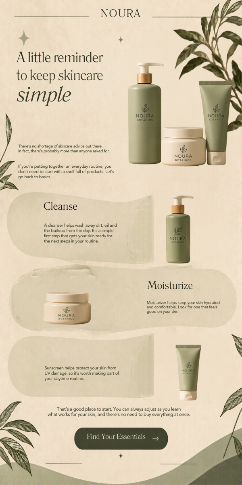
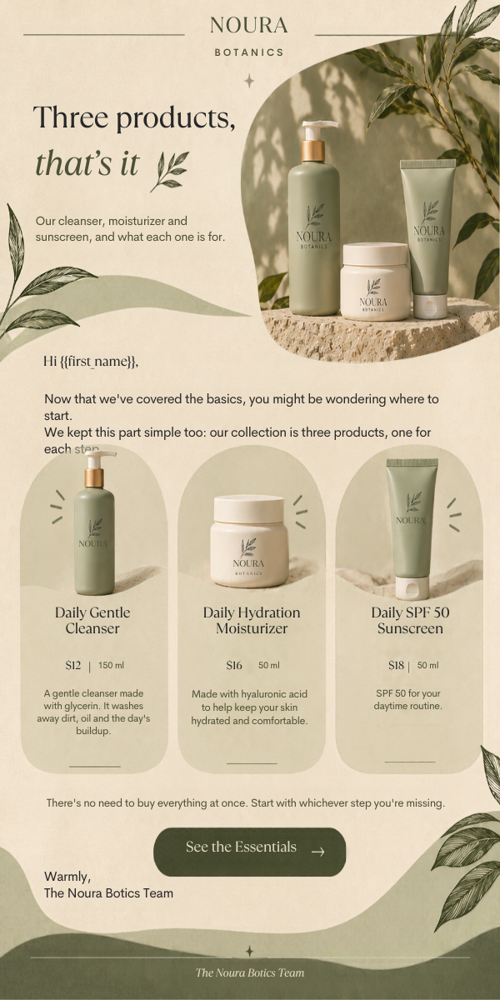

# Noura Botanics | Email Marketing Campaign

## Project Overview

This is a self-directed portfolio project created to demonstrate practical email marketing skills, including campaign strategy, audience research, customer segmentation, copywriting, email design, campaign planning and performance measurement.

The project follows the development of a three-part welcome email sequence for a fictional skincare brand, from initial research and planning through to the final email designs.

## Brand Overview

**Noura Botanics** is a fictional skincare and body-care brand created for this project.

The brand focuses on simple, affordable everyday skincare, with approachable routines and clear product information.

## Project Objectives

- Develop an email marketing strategy.
- Research competitors and the target audience.
- Create a customer persona.
- Develop an audience segmentation strategy.
- Write a three-part welcome email sequence.
- Design email marketing mockups.
- Develop an email campaign calendar.
- Establish a KPI measurement framework.

## Email Campaign Preview

### Email 1 – Welcome

[Welcome Email](04-email-designs/email-01-welcome.png.png)

### Email 2 – Skincare Basics

### Email 3 – Product Discovery

## Project Deliverables

| Section | Contents |
|---|---|
| [01 – Campaign Strategy](01-campaign-strategy/) | Campaign brief, brand positioning and objectives |
| [02 – Audience Research](02-audience-research/) | Competitor analysis, target audience, persona and segmentation |
| [03 – Email Copy](03-email-copy/) | Three completed welcome emails |
| [04 – Email Designs](04-email-designs/) | Three email design mockups |
| [05 – Campaign Calendar](05-campaign-calendar/) | Welcome email sequence schedule |
| [06 – Measurement](06-measurement/) | KPI and measurement plan |
| [07 – References](07-references/) | Research sources and references |

## Tools

- **Canva:** Email design mockups
- **GitHub:** Project organisation and documentation
- **Mailchimp:** Email marketing platform research
- **HubSpot Academy:** Marketing learning resources

## Project Status

In Progress – Portfolio case study development.

## Disclaimer

Noura Botanics is a fictional brand created for educational and portfolio purposes. All products, prices, product specifications and campaign materials are hypothetical.

The campaign was not deployed, and no actual subscriber, sales or performance data was generated.
